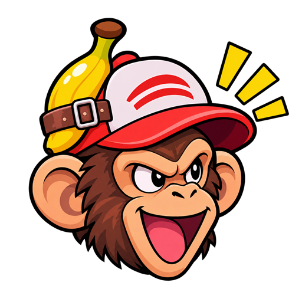

  

<h1 align="center">Monkey Catchers</h1>

  <b>Jogue PokeIdle com até 4 contas numa janela só.</b> 
  Com lives que rendem pontos e ferramentas que mostram onde vale a pena farmar.

  

  
  
  
  

---

## O que ele faz

<table>
  <tr>
    <td width="33%" valign="top">
      <h3>Catchers</h3>
      Até <b>4 contas</b> lado a lado, cada uma com seu próprio login. Fechou o app? Na próxima vez elas voltam já logadas.
    </td>
    <td width="33%" valign="top">
      <h3>Monkey Watchers</h3>
      Assiste às <b>lives oficiais</b> da Twitch e da Kick para você juntar <b>pontos de canal</b>. Se o streamer sair, troca sozinho.
    </td>
    <td width="33%" valign="top">
      <h3>Monkey Tools</h3>
      <b>Mercado</b>, <b>alertas de preço</b>, <b>calculadora de XP</b> e <b>Farm</b>, tudo preenchido com os dados das suas contas.
    </td>
  </tr>
</table>

## Começando em 3 passos

1. **Baixe** o arquivo no botão roxo lá em cima.
2. **Abra** e escolha um apelido.
3. **Entre** na sua conta do jogo. Quer mais contas? Clique no **+** lá em cima.

> [!TIP]
> O Windows pode avisar que o arquivo é desconhecido. Clique em **Mais informações** e depois em **Executar assim mesmo**.

## Tudo o que vem junto

- **Placas na tela** avisam cada captura, quando as Poké Bolas ou poções estão acabando e quando um item aparece no preço que você quer.
- **Mercado:** o que está subindo, o que está caindo e quanto cada coisa vale agora.
- **Calculadora de XP:** quanto tempo falta para o nível que você quer.
- **Farm:** as melhores hunts para o seu Pokémon, com XP, ouro e chance de shiny.
- **Baú da Twitch** coletado sozinho enquanto a live roda.
- **Modo leve:** as contas que você não está olhando gastam quase nada do PC.
- **Copiar e colar** com o botão direito em qualquer tela.
- **Atualiza sozinho:** quando sai versão nova, é só clicar em **Atualizar**.

## Dúvidas

<b>É seguro? O app vê minha senha?</b>

 
Não. Você faz login na própria página do jogo, e o app não lê nem envia senhas. Tudo fica só no seu computador.

<b>Preciso instalar alguma coisa?</b>

 
Não. É um arquivo só: baixou, abriu, pronto. Funciona no Windows 10 ou 11, de 64 bits.

<b>Meu PC ficou lento com 4 contas</b>

 
Deixe ligado o <b>modo leve</b> (a folha na barra de cima). Cada conta é uma página inteira do jogo, então PCs mais simples rodam melhor com menos contas.

<b>Não consigo entrar com o Google</b>

 
O login com Google às vezes é recusado dentro do app. Entre com usuário e senha do jogo.

<b>Por que o mercado começa vazio?</b>

 
O app vai guardando as vendas a cada hora enquanto uma conta está aberta. Em pouco tempo os gráficos se enchem.

## Autores

<table>
  <tr>
    <td align="center">
      <a href="https://github.com/raphasparda"> <b>raphasparda</b></a>
    </td>
    <td align="center">
      <a href="https://github.com/Okumagr"> <b>Okumagr</b></a>
    </td>
  </tr>
</table>

---

Projeto de fã, sem ligação com o PokeIdle, a Nintendo, a Game Freak, a Creatures ou a The Pokémon Company. Usar várias contas ou ferramentas externas pode ir contra as regras do jogo: confira os Termos de Uso do PokeIdle antes.
